<p align="center"></p>

<p align="center"><b>基于 Stripe 的 License Key 与文件交付服务，自托管。</b></p>
<p align="center">接口与 Lemon Squeezy 数字交付保持一致：改一个 base URL，老客户端照常工作；一键导入全部历史订单、License Key 和文件。</p>

<p align="center">
  <a href="#快速开始">快速开始</a> ·
  <a href="#从-lemon-squeezy-迁出">从 Lemon Squeezy 迁出</a> ·
  <a href="#接入-stripe5-步">接入 Stripe</a> ·
  <a href="docs/API_COMPATIBILITY.md">API 兼容性</a> ·
  <a href="docs/ARCHITECTURE.md">架构</a>
</p>

<p align="center">
  
  
  
  
  
</p>

<picture>
  <source media="(prefers-color-scheme: dark)" srcset="docs/screenshots/dashboard-dark.webp">
  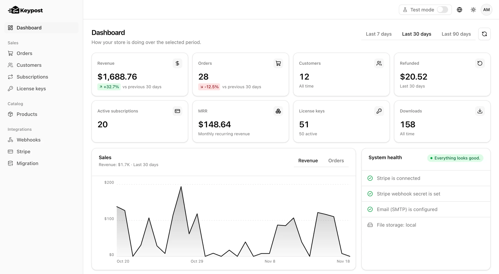
</picture>

## 为什么需要 Keypost

Lemon Squeezy 将于 **2027-03-31** 停止处理交易。官方建议迁到 Stripe Managed Payments，但它只负责收款：
**不交付 License Key、文件和下载链接，历史订单、Key、文件也不会自动迁移。** Keypost 补上这一层。

| 你在 Lemon Squeezy 上用到的 | 只用 Stripe | 加上 Keypost |
| --- | :---: | --- |
| License Key 与激活 / 验证 / 停用 API | ❌ | ✅ 请求、响应、错误文案、限流与 LS 一致，客户端只改 base URL |
| 订单、订阅、客户、JSON:API | 部分 | ✅ `/v1/*` 与 LS 同形状，官方 SDK 可通过自定义 base URL 使用 |
| 出站 Webhook（`order_created` 等 16 种） | ❌ | ✅ 同名事件、同 payload、同签名（HMAC-SHA256），验签代码不用改 |
| 文件交付与下载链接 | ❌ | ✅ 签名链接、过期时间、每文件每 IP 次数限制 |
| 客户自助页（My Orders） | ❌ | ✅ 魔法链接登录、License Key、下载、Stripe 账单门户 |
| 历史订单、Key、实例、文件 | ❌ | ✅ 一键导入，**保留原 ID、Key 字符串、实例 UUID 和文件本体** |

> **已和真实账号对拍过。** License API 和 JSON:API 用一个真实的 Lemon Squeezy 测试账号逐字段、逐场景比对过（激活、超限、验证、停用、过期……响应完全一致）；
> Stripe 侧在沙盒里跑通了付款、发货、退款、取消订阅。没有真实样本的资源（订阅、订阅发票、文件）按官方文档实现。详见 [API 兼容性](docs/API_COMPATIBILITY.md)。

## 特性一览

<table>
<tr>
<td width="33%" valign="top"><b>即插即用的兼容层</b><br>License API、JSON:API、出站 Webhook 与 Lemon Squeezy 一致，包含错误文案和事件顺序。把 <code>api.lemonsqueezy.com</code> 换成你的域名即可。</td>
<td width="33%" valign="top"><b>Stripe 履约</b><br>验签、幂等处理 Checkout、续费、失败、取消、退款，自动生成订单、订阅和 License Key，发收据邮件。</td>
<td width="33%" valign="top"><b>完整的数据迁移</b><br>从 LS API 或离线归档导入，Dry run、ID 冲突保护、LS→Stripe 客户映射、自动匹配、缺口报告。</td>
</tr>
<tr>
<td valign="top"><b>管理后台</b><br>订单（退款、补发收据、导出）、客户、订阅、License Key、商品与文件、Webhook 投递日志、Stripe 事件重放、API Key、成员、审计日志。中英双语，亮暗两套主题。</td>
<td valign="top"><b>安全默认值</b><br>所有成员强制两步验证（TOTP），支持「使用 Stripe 登录」；密钥 AES-GCM 加密落库；会话、下载、魔法链接均有签名与限流。</td>
<td valign="top"><b>好部署</b><br>Go 单二进制 + Next.js，PostgreSQL 18（也支持 SQLite），本地磁盘或 S3 存文件，<code>docker compose up</code> 即可跑起来。</td>
</tr>
</table>

## 产品预览

### 订单与退款

按订单号、邮箱、状态、日期筛选，一键退款（调用 Stripe Refund）、补发收据、导出 CSV。

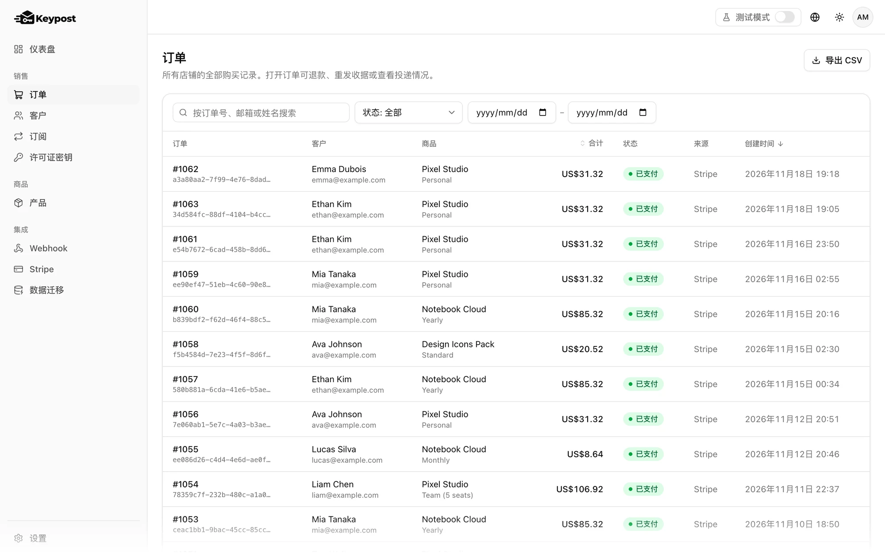

订单详情里能看到 License Key、文件、订阅和 Stripe 关联，所有操作都记入审计日志。

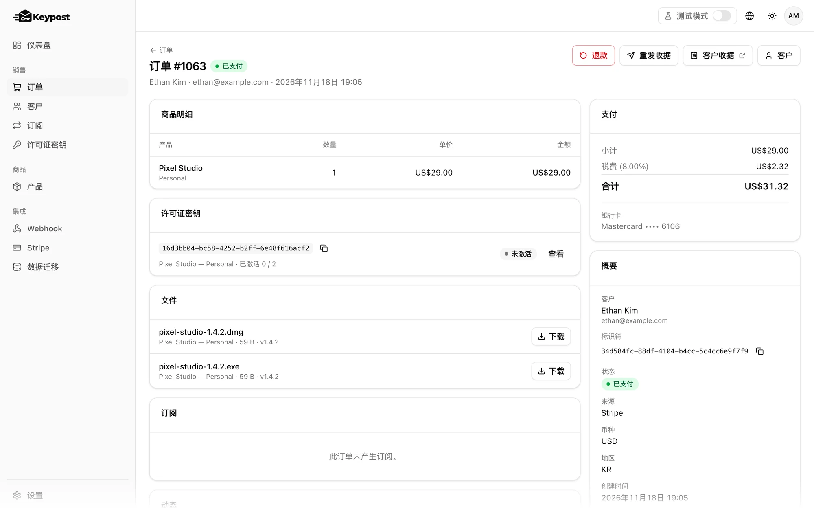

### License Key 与发货规则

订单支付后自动发货，退款或订阅失效后自动停用；激活数、有效期、停用状态一目了然。

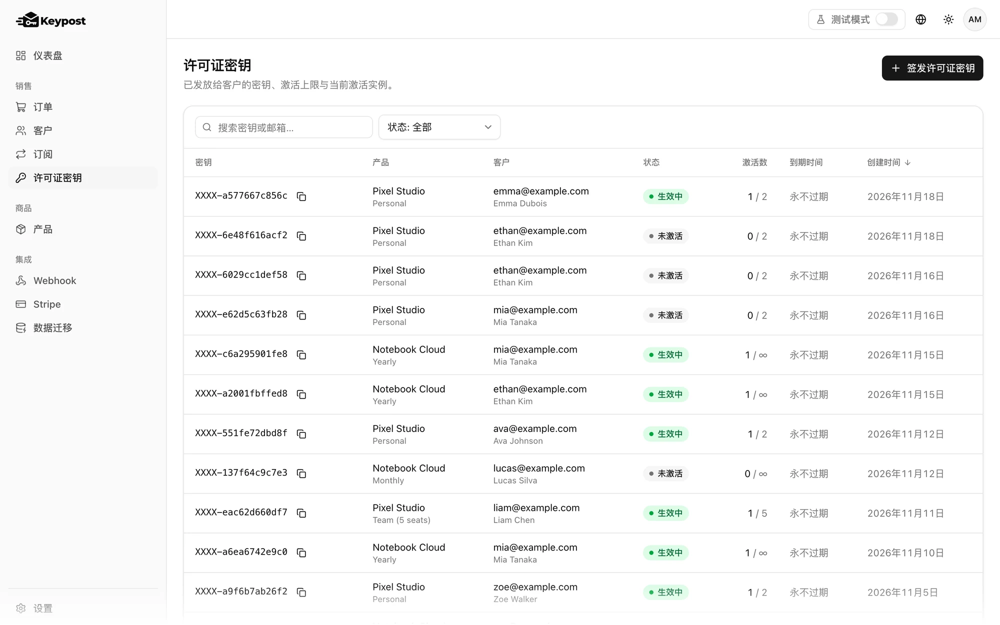

在变体上勾选「生成 License Key」，设置激活上限和有效期，上传文件，加外部链接（支持 `[license_key]`、`[order_id]`、`[email]` 等变量），并关联 Stripe 价格。

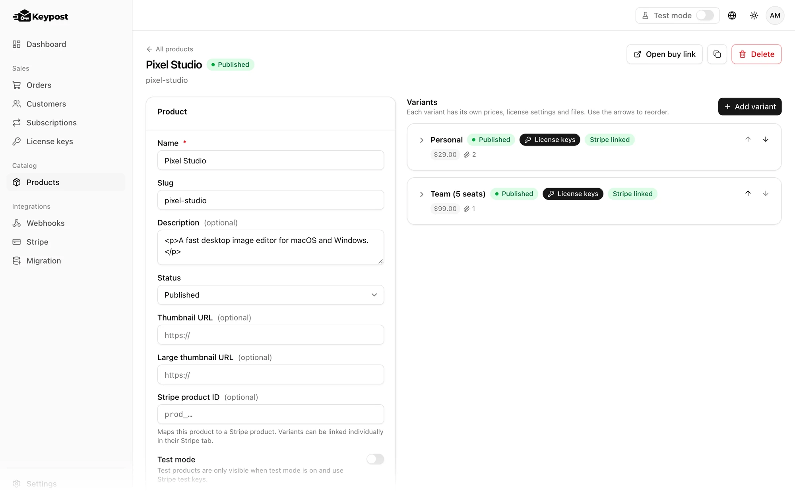

### 订阅

续费、失败、取消、暂停、过期都跟随 Stripe 事件自动同步，License Key 的有效期随订阅走。支持取消、恢复、暂停，或从 Stripe 重新对账。

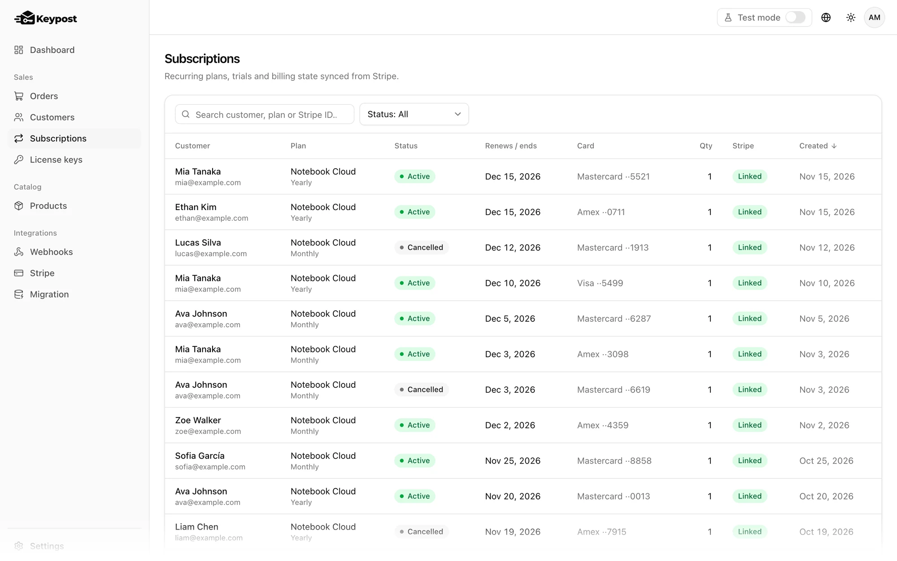

### 迁移中心

从 Lemon Squeezy 导入全部历史，导入前先 Dry run；遇到 ID 冲突默认停止，不会覆盖你已有的数据。导入后用映射表或「自动匹配」把客户、商品、订阅关联到 Stripe。

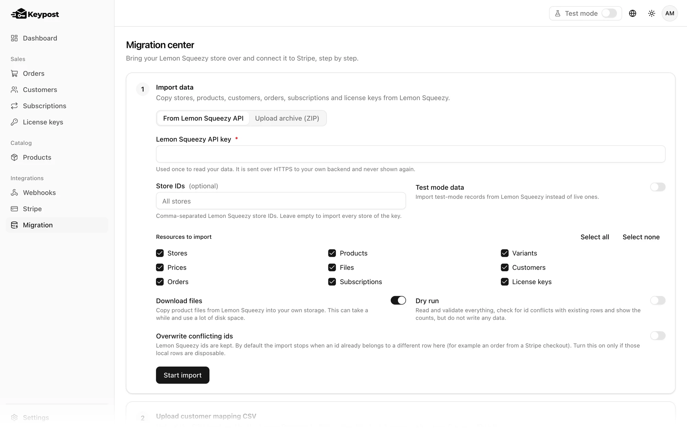

### 团队与安全

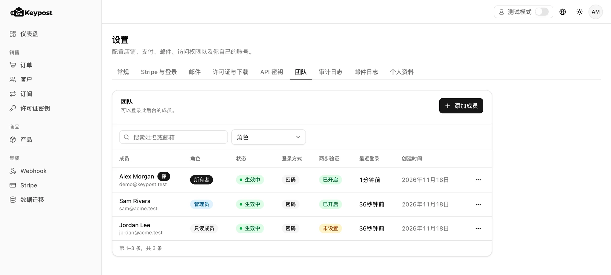

<table>
<tr>
<td valign="middle" width="56%">
<b>每位成员都必须开启两步验证</b>，没有关闭开关。
<ul>
<li>首次登录引导扫码，并发放 10 个一次性恢复码</li>
<li>邮箱密码和「使用 Stripe 登录」都要再过一步</li>
<li>验证码只能用一次，连续输错会锁定账号</li>
<li>owner 可以重置成员；唯一的 owner 丢设备，用 <code>dfctl admin reset-mfa</code></li>
<li>绑定、验证、重置都有审计记录</li>
</ul>
</td>
<td valign="middle" width="44%">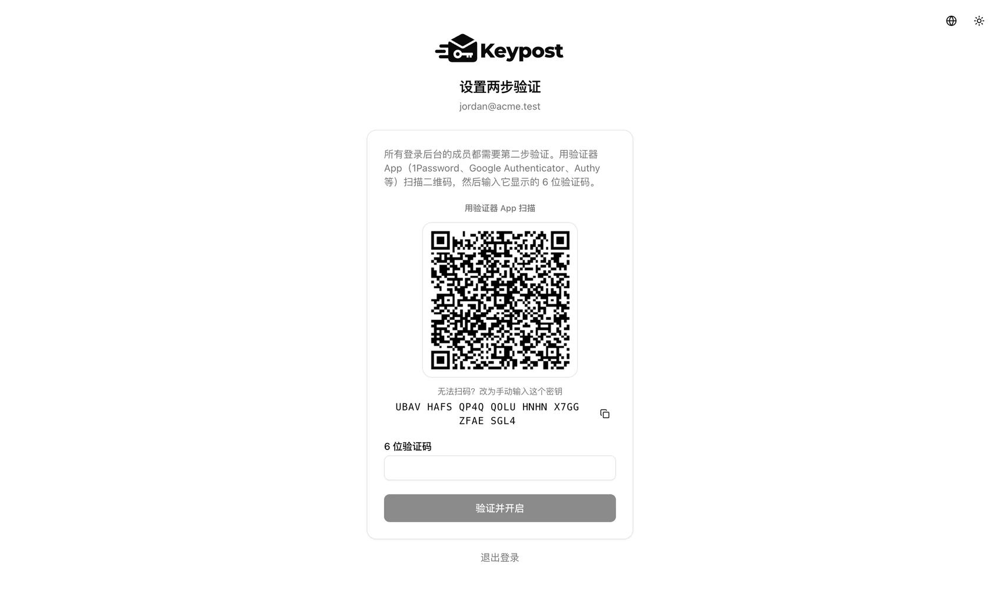</td>
</tr>
</table>

### 客户看到的

付款后直接跳到订单页；之后用邮箱魔法链接登录，随时找回 License Key、下载文件、进入 Stripe 账单门户。收据邮件有完整的 HTML 与纯文本版本，深色模式和手机屏幕都适配。

<table>
<tr>
<td width="44%" valign="top">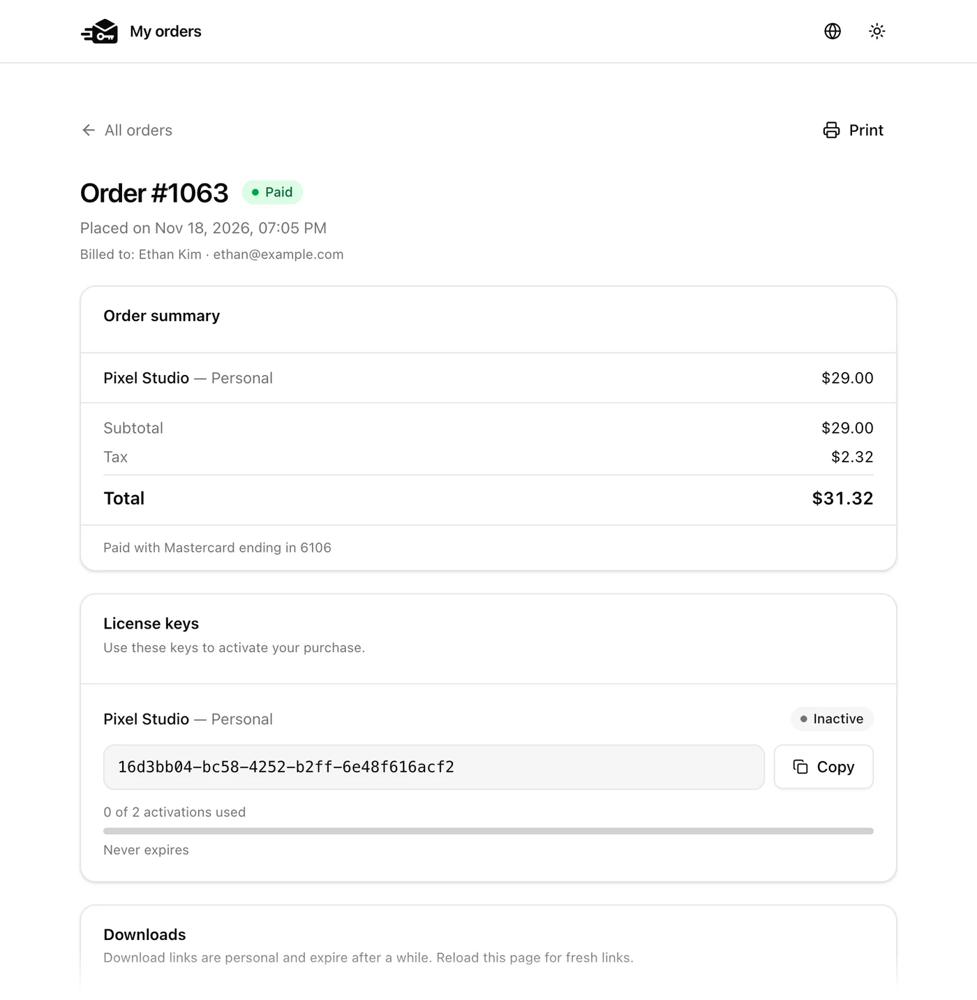</td>
<td width="20%" valign="top">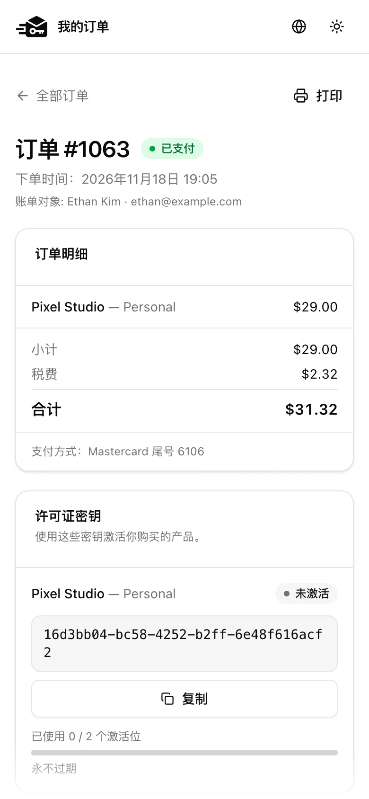</td>
<td width="36%" valign="top">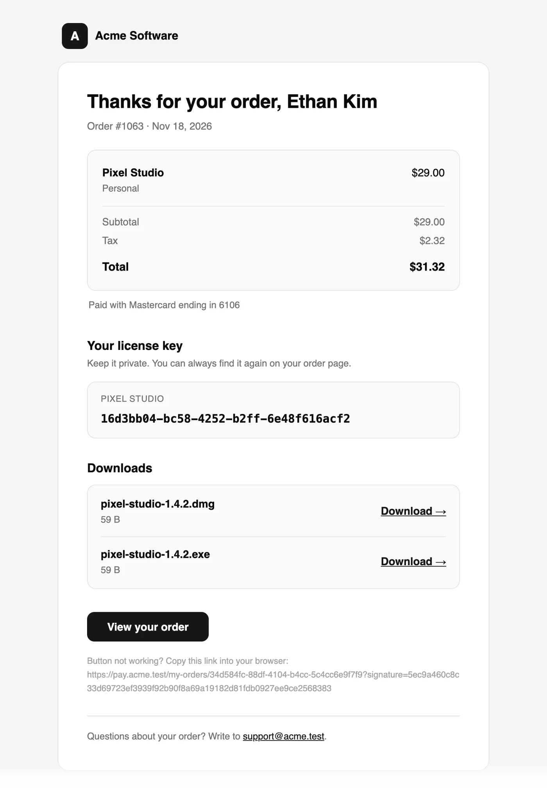</td>
</tr>
</table>

## 工作原理

```
 购买者 ──► Stripe Checkout ──► Stripe ──webhook──► /webhooks/stripe ─┐
 你的应用 ─► /v1/licenses/*  (License API, 无需鉴权)                   │
 你的服务端 ─► /v1/*  (JSON:API, Bearer Key)                           ▼
                                                            ┌──────────────────┐   出站 Webhook
 浏览器 ─► Next.js (:3000) ──rewrites──────────────────────►│  Go API (:8080)  │──► 你的业务系统
            /admin  管理后台                                 │  履约 · 授权 · 导入 │
            /my-orders  客户页面                             └───────┬──────────┘
                                                              PostgreSQL / SQLite   本地磁盘 / S3
```

- **后端**：Go（标准库 `net/http` + GORM），PostgreSQL 18（推荐）或 SQLite；没有第三方 Stripe SDK，内置轻量客户端并**同时兼容 basil 前后的响应形状**。
- **前端**：Next.js App Router + Tailwind v4 + shadcn/ui。同源反代，浏览器只访问 `:3000`。

## 快速开始

### Docker Compose（生产形态）

```bash
cp .env.example .env          # 填 PUBLIC_URL / APP_SECRET / POSTGRES_PASSWORD / STRIPE_* …
docker compose up -d --build
docker compose logs backend | grep setup_token   # 首次启动：打开 /admin 用该令牌创建 owner
```

或在 `.env` 设置 `ADMIN_EMAIL` / `ADMIN_PASSWORD` 直接创建 owner。把 TLS 反向代理指到 `:3000`（API 路径 `/v1`、`/download`、`/webhooks` 可直连后端 `:8080` 以减少一跳）。
首次登录会引导绑定两步验证。

### 本地开发

```bash
make dev-backend     # Go API :8080（SQLite ./backend/data）
make dev-frontend    # Next.js :3000（代理到 :8080）
make test            # 后端测试（SQLite 内存库 + -race）
make test-pg         # 同一套测试跑在真实 PostgreSQL 18 上
```

想先看看效果：`dfctl demo-data` 会往空库里灌入商品、客户、订单、订阅和 License Key 的演示数据，不需要 Stripe 账号。

### 关键配置

| 变量 | 说明 |
| --- | --- |
| `PUBLIC_URL` | 对外地址（邮件、Webhook 回调、签名链接都用它） |
| `APP_SECRET` | 加密密钥和签名密钥的根，**一旦设定不要更换** |
| `DATABASE_URL` | `postgres://…`（推荐）或 `sqlite:./data/fulfillment.db` |
| `STRIPE_SECRET_KEY` / `STRIPE_WEBHOOK_SECRET` | 也可以在后台 *设置 → Stripe* 里填 |
| `SMTP_*` | 收据和登录链接邮件 |
| `STORAGE_DRIVER` | `local` 或 S3（`S3_*`） |
| `MFA_REQUIRED` | 默认 `true`，强制所有成员两步验证；`false` 仅用于本地开发 |

完整列表见 [.env.example](.env.example)。

## 接入 Stripe（5 步）

1. **密钥**：后台 *设置 → Stripe* 填 `Secret key`（建议 Restricted Key：Checkout Sessions、Customers、Subscriptions、Invoices、Charges、Refunds、Billing Portal、Products/Prices 读写，Webhook Endpoints 写）。
2. **Webhook**：*Stripe* 页点「创建 / 更新 Webhook Endpoint」，自动在 Stripe 建好 `PUBLIC_URL/webhooks/stripe` 并保存签名密钥（也可手动配置，事件见 `docs/ADMIN_API.md` §4）。
3. **目录**：*Stripe → 目录* 一键把 Stripe Products/Prices 导入为商品/变体/价格（或在变体上手动「关联 Stripe」）。迁移场景下 LS 的每个 variant 对应一个 Stripe product。
4. **发货规则**：在变体上勾选「生成 License Key」、设置激活上限/有效期，上传文件，加外部链接（支持 `[license_key] [order_id] [email] …` 变量）。
5. **下单入口**：商品的 `buy_now_url`（`/checkout/buy/{variant_slug}`）或 `POST /v1/checkouts`（与 LS 同参：`checkout_data.email/custom`、`custom_price`、`product_options.redirect_url`），自动创建 Stripe Checkout Session。付款后回到 `/checkout/success`，直接跳到带签名的订单页（或你配置的 `redirect_url`）。

> **Managed Payments**：设置里打开「Managed Payments」，创建 Checkout Session 时会带 `managed_payments[enabled]=true`（需 Stripe 账户已开通，且按 Stripe 要求使用对应的 API 版本）。
> 没打开该设置时，若 Stripe 账户默认开启了 Managed Payments（会要求每个商品有 product tax code），创建 Session 会收到 Stripe 的提示并自动带 `managed_payments[enabled]=false` 重试一次。

## 从 Lemon Squeezy 迁出

1. 后台 *迁移* → 填 LS API Key（只读即可）→ 先 **Dry run** 看数量和 ID 冲突 → 正式导入（含文件下载）。也支持离线 ZIP（`scripts/export-lemonsqueezy.py` 在本机导出，Key 不出你的电脑）与订单 CSV。
2. 上传 LS 迁移工具给出的「LS 客户 ID → Stripe 客户 ID」映射表；对订阅、商品同理。其余用「自动匹配」按邮箱/名称匹配，*下载缺口报告* 处理剩余项。
3. 把应用里的 `https://api.lemonsqueezy.com` 换成你的域名，License Key、实例 ID、Webhook 处理逻辑无需改动；把新 Webhook 的 URL/Secret 配上。
4. 在 LS 停止服务（2027-03-31）前完成切换。

完整步骤、归档格式与回滚建议见 [docs/MIGRATION.md](docs/MIGRATION.md)。

## 管理后台的安全

**两步验证，所有成员强制开启，没有关闭开关**：邮箱密码登录和「使用 Stripe 登录」之后都要再过一次 TOTP（1Password、Google Authenticator、Authy 等都支持）。
首次登录会引导扫码绑定并给出 10 个一次性恢复码；之后每次登录输入 6 位验证码，丢了手机可用恢复码。成员丢设备时，owner 在 *设置 → 团队* 里「重置两步验证」，
唯一的 owner 丢设备则在服务器上执行 `dfctl admin reset-mfa --email you@example.com`。

**使用 Stripe 登录**（Stripe Connect OAuth）：

- 在 Stripe → Connect → OAuth 设置里启用并登记回调 `PUBLIC_URL/admin-api/auth/stripe/callback`，把 `client_id`（`ca_…`）填到 *设置 → Stripe 与登录*。
- 默认 `allowlist` 模式：只有「已绑定到某个后台用户」或在 `ADMIN_STRIPE_ACCOUNTS` 白名单里的 `acct_…` 才能登录；已登录用户可在 *个人资料* 里绑定/解绑。
- Stripe 的 OAuth 需要 `read_write` scope，所以**登录成功后会立即调用 deauthorize 撤销平台对该账号的授权**（只取身份，不留访问权），可在设置里关闭。
- 注意：Connect 平台与被登录的账号通常需要是**两个不同的 Stripe 账号**；Stripe 官方也不建议新平台使用 OAuth，它是目前唯一官方提供「Stripe 账号身份」的网页登录流程。邮箱密码登录始终可用。

## 文档

| 文档 | 内容 |
| --- | --- |
| [docs/ARCHITECTURE.md](docs/ARCHITECTURE.md) | 组件、数据流、安全模型、数据模型 |
| [docs/API_COMPATIBILITY.md](docs/API_COMPATIBILITY.md) | 与 Lemon Squeezy API 的逐项兼容矩阵 |
| [docs/MIGRATION.md](docs/MIGRATION.md) | 迁移步骤、归档格式、ID 冲突保护、回滚 |
| [docs/ADMIN_API.md](docs/ADMIN_API.md) | 管理后台 API 契约 |
| [docs/FRONTEND_NOTES.md](docs/FRONTEND_NOTES.md) | 前端结构、shadcn/ui 与主题 |
| [docs/RESEARCH_LEMONSQUEEZY.md](docs/RESEARCH_LEMONSQUEEZY.md) | Lemon Squeezy 数字交付调研 |

## 目录结构

```
backend/    Go 服务（cmd/server, cmd/dfctl, internal/*）
frontend/   Next.js 管理后台 + 客户页面（shadcn/ui）
docs/       调研、架构、API 契约、迁移指南、截图
scripts/    离线导出脚本等
```

## 已知限制

- 不含：折扣码/联盟营销/用量计费（`discounts`、`affiliates`、`usage-records` 返回明确的 404）；促销码请用 Stripe 原生 Promotion Codes。
- 只有经本服务结账（`buy_now_url` / `POST /v1/checkouts`）创建的订阅，首单才会生成订单和 License Key；在 Stripe Dashboard / API 里直接创建的订阅，其**首张**发票会被忽略（续费、失败、取消等后续事件在订阅已登记时照常处理）。迁移来的订阅请用导入器登记。
- 订阅「改套餐」请走 Stripe Billing Portal；`PATCH /v1/subscriptions` 仅支持取消/恢复/暂停。
- 订单的 `*_usd` 换算使用内置近似汇率表（可用环境变量 `FX_RATES='{"EUR":1.09}'` 覆盖，单位：1 个货币单位折合多少美元），仅用于报表，不影响实际扣款。
- 运维：每个实例需要一个公网 HTTPS 地址供 Stripe Webhook 回调。多实例部署时，Webhook 投递与导入任务用数据库租约避免重复，但限流是进程内的。
- 收据和登录邮件目前只有英文。
